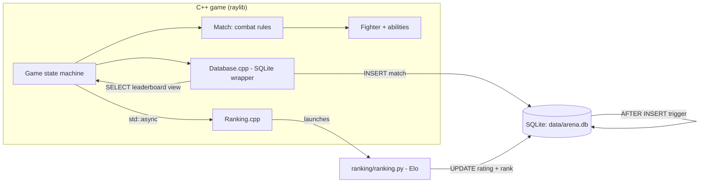
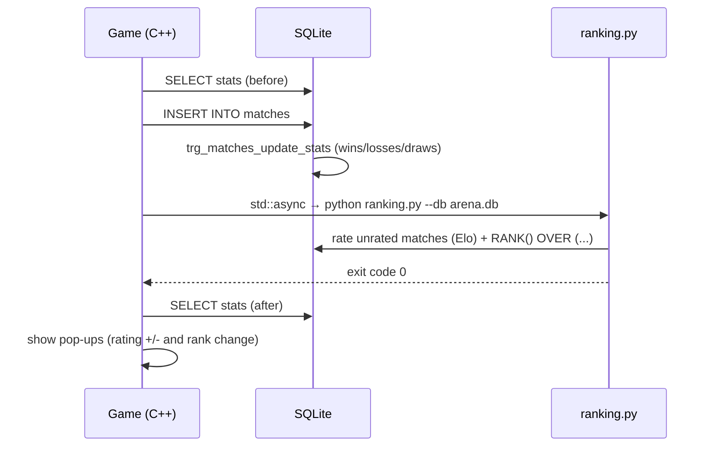
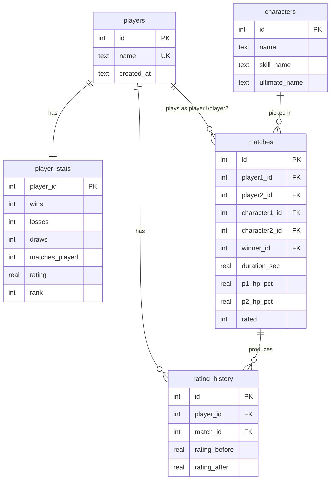

# Arena Fighters

A local **1v1 fighting game** written in **C++** with a **SQL** persistence layer and a **Python** ranking service.
Two players share one keyboard, pick from **8 characters**, and fight. After each match the result goes into a
relational database, where an **SQL trigger** updates wins and losses. A **Python Elo service** then recalculates
ratings and ranks, and the game shows the changes as **animated pop-ups** and on a **live leaderboard**.

> Academic project for the Game Development course, Ariel University (2025).

> **About this code:** this repository is a 2026 rewrite of my original course project, built with AI-assisted development (Claude Code) as hands-on practice with AI tools. The original design, game/system logic and requirements come from the 2025 project.

**Author:** Ilay Yerushalmi · [github.com/Ilay-Yerushalmy](https://github.com/Ilay-Yerushalmy)

---

## Features

| Area | What is implemented |
|---|---|
| Gameplay | Local PvP, movement, jumping, blocking, melee attacks, hit-stun, 99-second timer, K.O. / time-out |
| Characters | 8 characters, each with unique stats, **1 time-restricted skill** (cooldown) and **1 ultimate** that needs a full **energy bar** |
| Combat resource | Energy fills up dynamically: +12 per hit dealt, +8 per hit taken, +1.5 per second passively |
| Status effects | Stun, poison (damage over time), shield, damage-up, haste, regeneration |
| Database | SQLite schema with FKs, CHECK constraints, indexes, **2 triggers** and **2 views** |
| Ranking | Python Elo rating with a dominance bonus, competition ranking with `RANK()` window function, rating history |
| Integration | The C++ engine launches the Python service asynchronously (`std::async`), so the window never freezes |
| UI | Name entry, character select, HUD, floating damage numbers, animated stat pop-ups, leaderboard |
| Quality | C++ DB tests (CTest), Python unit + integration tests, GitHub Actions CI |

---

## Architecture



### What happens after a match



---

## Characters

| # | Character | HP | Skill (cooldown) | Ultimate (full energy) |
|---|---|---|---|---|
| 1 | **Blaze** | 100 | Fireball: projectile (2.5s) | Inferno: 3 large fireballs |
| 2 | **Frost** | 100 | Ice Shard: projectile with stun (4s) | Blizzard: full-screen 2s freeze |
| 3 | **Titan** | 130 | Ground Slam: area hit and stun (5s) | Unstoppable: double damage for 6s |
| 4 | **Shade** | 85 | Shadow Step: teleport behind the opponent (4s) | Assassinate: 30-damage dash |
| 5 | **Volt** | 95 | Lightning Dash: damaging dash (3.5s) | Overcharge: 1.6x speed for 6s |
| 6 | **Sage** | 90 | Mend: heal 15 HP (8s) | Sanctuary: regenerate 6 HP/s for 6s |
| 7 | **Ronin** | 105 | Iron Guard: full shield for 1.5s (6s) | Thousand Cuts: 6-hit flurry |
| 8 | **Viper** | 95 | Poison Dart: projectile with poison (3s) | Venom Cloud: poison area |

Abilities are **data-driven** (`AbilityDef` in [src/Characters.h](src/Characters.h)). To add a character you only
add data; you don't write new code.

## Controls

| Action | Player 1 | Player 2 |
|---|---|---|
| Move | `A` / `D` | `←` / `→` |
| Jump | `W` | `↑` |
| Block | `S` | `↓` |
| Attack | `F` | `I` |
| Skill | `G` | `O` |
| Ultimate | `H` | `P` |

Menus: `Tab` switches the player name field, `Enter` confirms, `F1` opens the leaderboard, `Esc` goes back.

---

## Database design



Highlights (see [db/schema.sql](db/schema.sql)):

- **`trg_players_create_stats`** creates a stats row automatically for every new player.
- **`trg_matches_update_stats`** updates `wins / losses / draws / matches_played` for both players when a match is
  inserted. The game code never updates counters by hand, so they can't get out of sync.
- **CHECK constraints** make sure a player can't fight themselves, the winner is one of the two players, and HP is
  between 0 and 100.
- **`leaderboard` view** and **`character_stats` view** (pick rate and win rate per character, used for balancing).
- Every query in C++ is a **prepared statement** with bound parameters, which protects against SQL injection.

## Ranking algorithm

Implemented in [ranking/ranking.py](ranking/ranking.py):

1. Pending matches (`rated = 0`) are processed in chronological order.
2. Expected score: `E = 1 / (1 + 10^((R_opp - R_self) / 400))`
3. K-factor scaled by dominance: `K = 32 × (1 + 0.5 × winner_hp% / 100)`. A flawless win moves the rating 1.5× more.
4. `ΔR = K × (S − E)`, where S = 1 for a win, 0.5 for a draw and 0 for a loss. The update is zero-sum.
5. Ranks are recomputed with a SQL window function: `RANK() OVER (ORDER BY rating DESC)`.
6. Everything runs in **one transaction**, and running the script twice changes nothing (idempotent).

---

## Getting started

### Requirements
- CMake ≥ 3.20 and a C++20 compiler (Visual Studio 2022, GCC 11+, or Clang 14+)
- Python ≥ 3.9 (standard library only, nothing to `pip install`)
- Internet access on the first build (CMake downloads raylib and SQLite automatically)

### Build & run

```bash
cmake -S . -B build
cmake --build build --config Release
```

Windows (Visual Studio generator):
```bash
build\Release\arena_fighters.exe
```

Linux / macOS:
```bash
./build/arena_fighters
```

The database is created automatically at `data/arena.db` on the first run.

| Environment variable | Purpose | Default |
|---|---|---|
| `ARENA_ROOT` | Folder containing `db/` and `ranking/` | project source folder |
| `ARENA_PYTHON` | Python interpreter to run the ranking service | `python` (Windows) / `python3` |

> Windows note: clone the repo to a path that contains only English characters. Some tools have trouble with non-ASCII paths.

### Run the ranking service by hand

```bash
python ranking/ranking.py --db data/arena.db --leaderboard
```

### Tests

```bash
python -m unittest discover -s ranking/tests -v
```

```bash
ctest --test-dir build -C Release --output-on-failure
```

---

## Project structure

```
arena-fighters/
├── CMakeLists.txt          # build + automatic download of raylib & SQLite
├── src/
│   ├── main.cpp            # entry point
│   ├── Game.*              # screen state machine, saving results, pop-ups
│   ├── Match.*             # combat rules, abilities, projectiles, HUD
│   ├── Fighter.*           # per-player state: HP, energy, cooldowns, buffs, physics
│   ├── Characters.*        # the 8 character definitions (data-driven)
│   ├── Database.*          # RAII SQLite wrapper (prepared statements)
│   ├── Ranking.*           # launches the Python service
│   ├── UI.*                # bars, text, animated pop-ups
│   └── Config.h            # all tuning constants in one place
├── db/
│   ├── schema.sql          # tables, constraints, indexes, triggers, views
│   └── seed.sql            # character catalog
├── ranking/
│   ├── ranking.py          # Elo service (CLI)
│   └── tests/test_ranking.py
├── tests/test_database.cpp # C++ persistence tests (CTest)
├── data/                   # runtime database (git-ignored)
└── .github/workflows/ci.yml
```

## Design decisions

- **Why a separate Python process instead of embedding Python?** It keeps the C++ build simple, since no Python dev
  headers are needed. The service can also run on its own (batch recalculation, CLI). The shared SQLite file is the
  integration contract.
- **Why triggers for wins and losses?** The database stays correct no matter who inserts a match: the game, a script
  or a test.
- **Why data-driven abilities?** Balancing and new characters are data changes, not code changes.
- **Why `std::async`?** Launching a process takes ~100 ms. Running it in the background keeps rendering at 60 FPS.

## Possible extensions

- Online play over sockets, plus an AI opponent for single-player
- Sprite animations and sound effects
- Best-of-3 rounds
- Match replay from stored inputs
- Unit tests for combat logic, after separating it from raylib input
